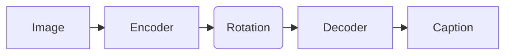

On 29 October 2026, Randall Balestriero and Yann LeCun posted [Proving and Improving the Platonic Representation Hypothesis with JEPAs](https://arxiv.org/abs/2610.39302) (arXiv 2610.39302, v1). Every figure below comes from the paper. The suggestions under "What I would try" are my own reading, and I have not reproduced any result.

The short version:

- **Claim:** models trained on different data types end up with the same internal picture of the world, up to one rotation, if they learn from the right kind of positive pairs.
- **Evidence:** a 109M-parameter text model trained this way lines up with vision encoders better than language models up to 72B parameters. It also needs 42 times fewer samples than next-token prediction to reach the same alignment.
- **Catch:** the proof assumes an idealised world, and the best results are on text. Image encoders are not yet trained this way.

## The idea: two mapmakers

The Platonic Representation Hypothesis (Huh et al., 2024) says that models trained on different kinds of data, such as text and images, drift toward the same internal picture of the world as they scale.

Picture two mapmakers. One works from satellite photos, the other from travellers' diaries. They never meet. The hypothesis says their finished maps will match, except that one is turned on the table. Until now that was an observation. This paper tries to prove it, and to give a recipe that gets there with less data.

## JEPA in one paragraph

A Joint-Embedding Predictive Architecture (JEPA) learns by comparing embeddings instead of predicting raw pixels or words. You show it two *views* of the same thing and train it to put their embeddings close together. Left alone it would cheat by mapping everything to one point, so an anti-collapse term spreads the embeddings out. The paper uses SIGReg from LeJEPA, which pushes embeddings toward an isotropic Gaussian, meaning a round, evenly spread cloud.

## What the paper proves

<Callout type="formula" title="Theorem 1, in one line">

Train one JEPA per modality, all using positive pairs that come from the same world state. Any two of them then agree up to a single rotation:

$$ f_a(x_a) = R_{ab}\, f_b(x_b), \qquad R_{ab}^\top R_{ab} = I $$

</Callout>

The rotation is the one turn of the page that lays one map over the other. Nothing else needs to change: the layout, the distances and the neighbours all match.

The conditions matter. The theorem assumes a finite world, that every world state looks different when rendered, infinite data, and minimisers that are unique up to rotation. It covers identity predictors only, not JEPAs with learned or action-conditioned predictors.

Theorem 2 covers the messy case. When two modalities disagree about which pairs count as positive, the misalignment is bounded by the difference between their positive-pair kernels, scaled by the eigengap. The more your modalities disagree about what counts as "the same thing", the further the maps drift.

## Good views and bad views

Everything hangs on what you call a positive pair. The paper draws a line:

- **Good view:** two observations of world states that the world itself relates. A photo and its caption, two captions of one photo, frames of one clip.
- **Bad view:** two corruptions of a single observation, such as two crops of one photograph.

Think of checking whether someone really knows a person. Showing them two crops of the same passport photo tests the photo: its lighting, its camera, its framing. Showing two different photos of that person tests the person. A model trained on crops can win by matching the quirks of the photo, so it spends embedding space on things unrelated to the scene. The paper proves this nuisance costs alignment (Theorem 3), and that good-view JEPAs spend no directions on it (Proposition 3).

Next-token prediction fits the bad-view pattern. Its positives are a prefix and its continuation inside one document, and both share the document's author, wording and style. The paper calls it an inefficient bad-view JEPA (Proposition 4) and says this explains why language models align with vision mainly through scale.

## What the numbers say

**Sample efficiency.** A good-view text JEPA reached, with 21.6M samples, the alignment that next-token prediction needed 900M samples to reach. That is the 42x in the abstract.

**Against much larger models.** Table 3 compares a 109M-parameter good-view JEPA with language models of 70B and 72B parameters. The score is mutual 10-nearest-neighbour agreement: for paired items, how much the 10 nearest neighbours in the text space overlap with those in the image space. Higher means the two spaces are organised more alike.

| Text model | WIT, DINOv2-B | WIT, CLIP-H | COCO |
| --- | --- | --- | --- |
| 109M good-view JEPA | .184 | .230 | .161 |
| Qwen2.5-72B | .154 | .210 | .108 |
| Llama-3-70B | .151 | .206 | .113 |

This measures agreement with vision encoders. It does not show that the 109M model is a better language model.

## Use cases

The paper builds three demonstrations on one idea: if the spaces already match up to a rotation, fitting that rotation is cheap.



### Captioning without caption training

Freeze DINOv2 ViT-g and DINOv3 ViT-L as the eyes. Fine-tune a Qwen2.5-1.5B decoder on text only. Fit one map on 30k Flickr image-caption pairs. The result is a CIDEr score of .838 on COCO.

It is not the best captioner. CapDec (.918) and DeCap (.912), which the paper lists as baselines, score higher, but they use CLIP encoders trained on 400M image-text pairs. Here the only part trained on pairs is a single rotation.

### Alignment with zero pairs

With a pile of images and a pile of texts and no pairing at all, geometry can recover the rotation. The paper builds on Schnaus et al., who match clusters and refine with optimal transport.

On ImageNet-100 zero-shot, the 109M JEPA reaches 64.4% top-5. The best language-model setting reported by Schnaus et al. is 56%, and a Qwen3-8B rerun gets 47.6%. CLIP B/32's text encoder, which does train on pairs, still scores 68.7%. Captioning Flickr with no pairs gives a CIDEr of .158, against .430 with the 30k-pair rotation.

### Reusing the rotation on video

A rotation fitted on photos carries over to video clips. Averaging the embeddings of eight frames from each MSR-VTT clip gives a CIDEr of .246 against the 20 human captions per clip. VideoCoCa scores .271 after training on 144M video-text pairs. For retrieval, the rotation finds the right clip first for 16.5% of captions, against 31.2% for CLIP ViT-B/32.

## What I would try

None of this is tested in the paper, so treat it as a plan to check, not a result.

1. **Bridge two frozen encoders in a specialised domain.** Where paired data is scarce, such as medical images and their reports, fit a rotation on a small paired set and measure retrieval before paying for contrastive pre-training. A rotation between two embedding sets has a closed-form fit:

```python
from scipy.linalg import orthogonal_procrustes

# X: (n, d) image embeddings, Y: (n, d) text embeddings for n paired examples.
# Assumes equal dimensions; centre and normalise both first.
R, _ = orthogonal_procrustes(X, Y)   # best single rotation taking X to Y
image_in_text_space = X_new @ R
```

2. **Design positives, not augmentations.** If you train embedding models, build positive pairs from different observations of the same thing: several captions per image, several frames per clip, several reports per incident. The paper's evidence is that this beats scale on alignment.

## Limits to keep in mind

- **Idealised theory.** Finite world, infinite data, identity predictors only.
- **Good views need labels you may not have.** You must know which texts describe the same scene. On Recap-DataComp, two of the three texts per image are generated by an image captioner, so a vision model has already shaped some of the text.
- **The image side is not good-view yet.** DINOv2 and the authors' own image encoders are bad-view JEPAs. Scaling good image views is left to future work.
- **Training can collapse.** Without gradient clipping, 3 of 36 runs at the default SIGReg weight collapsed.
- **The scaling law is a fit, not a law.** The authors call it an empirical summary of one recipe, with poorly identified exponents.
- **It is a v1 preprint.** It has not been through peer review, and I have not reproduced any number in it.

The authors close by arguing that positive views, and not scale alone, are the lever for building platonic representations. If the results hold, the practical lesson is about data: choose what counts as "the same thing" before you choose how much to train.

*Source: [arXiv:2610.39302](https://arxiv.org/abs/2610.39302), also available as [HTML](https://arxiv.org/html/2610.39302v1).*
