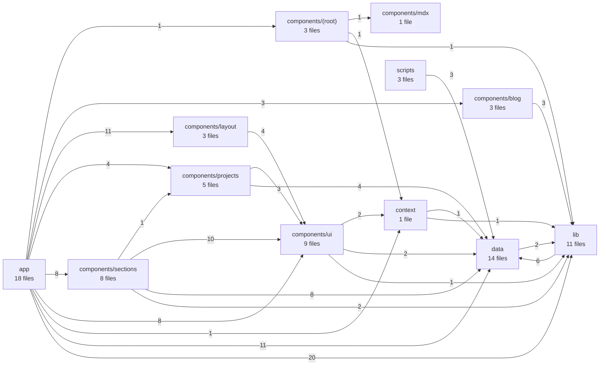
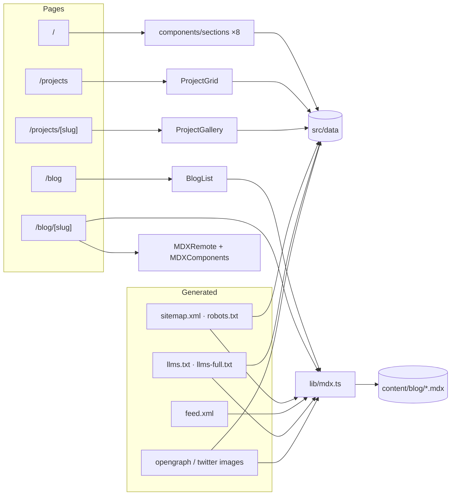
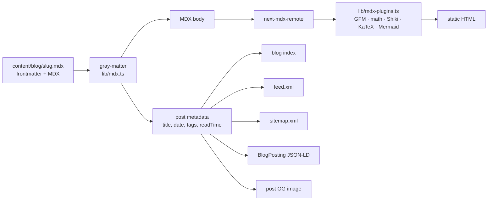
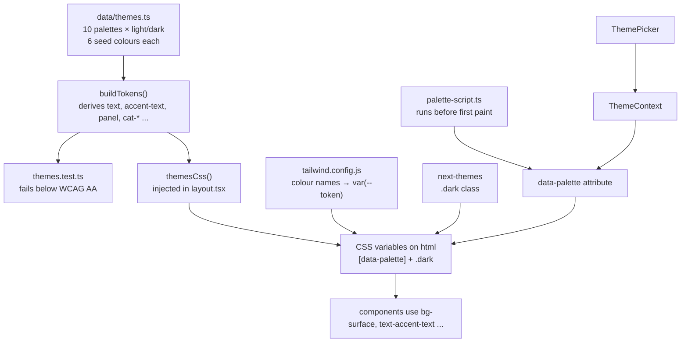

# Architecture

A statically exported Next.js 15 (App Router) portfolio. Everything is rendered at build time, so there is no server runtime to reason about: content goes in, HTML comes out, and the only client-side code is interaction and theming.

Think of it as a print shop. `data/` and `content/` are the manuscripts, `lib/` is the typesetting machinery, `components/` are the page templates, and `app/` is the press that stamps out one HTML file per route.

## Layers

Dependencies point one way: `app → components → lib → data`. Nothing in `data/` imports from a component, which is why content edits never touch layout code. The one upward edge is `data/themes.ts` importing `lib/color.ts`, a leaf helper with no imports of its own, so there is no cycle.

<!-- generated:start -->
_79 modules, 142 internal imports, 25 external packages. Generated by `npm run architecture`._

- **Import cycles:** none
- **Client vs server:** 22 of 46 `.tsx` modules are `"use client"`
- **Declared but never imported:** `react-icons`, `shiki`
- **Most depended-on modules (fan-in):** `lib/mdx.ts` (11), `data/site.ts` (11), `data/projects.ts` (10), `components/ui/JsonLd.tsx` (6), `lib/seo.ts` (6), `components/ui/SectionHeader.tsx` (6), `components/layout/Header.tsx` (5), `components/layout/Footer.tsx` (5)
<!-- generated:end -->

Regenerate with `npm run architecture` after adding or moving modules. Of the two unused dependencies, `shiki` is a peer of `rehype-pretty-code` and must stay; `react-icons` has no importer and can be removed.

## Routes

Both dynamic routes export `generateStaticParams`, which is what keeps `output: "export"` working.

## Blog pipeline

A new post is one file. Drafts (`draft: true`) are filtered out of production builds in `getBlogPosts()`.

## Theme pipeline

Two independent axes, so any palette works in either mode.

Rule of thumb: style with tokens, never literal colours. A literal colour is the one thing the contrast test cannot see.

## Client and server split

Components that need hooks, browser APIs, Framer Motion or the theme context carry `"use client"`. Content-only components stay on the server. Heavy client code (Mermaid, Framer Motion feature set) is loaded lazily through `MermaidLazy.tsx` and `lib/motion-features.ts`.
